# Esquema de Fit Home

`users.id` conserva su bigint. Las entidades nuevas tienen UUID y marcas de tiempo. Las claves externas restringen la eliminación de registros referenciados.

| Tabla | Columnas de dominio |
| --- | --- |
| users | public_id, name, last_name, email, password, status |
| `equipment` | slug, name, brand, model, category, description, active |
| `equipment_capabilities` | equipment_id, slug, name, verified |
| `user_equipment` | user_id, equipment_id |
| `muscle_groups` | slug, name, parent_id |
| `exercises` | slug, name, description, instructions, category, movement, difficulty, measurement, safety_notes, active, media_url, penalty_eligible, rep_limits, lower_impact_id |
| `exercise_muscle_groups` | exercise_id, muscle_group_id, role |
| `exercise_equipment` | exercise_id, equipment_id, capability_id, accessory |
| `guest_access_tokens` | user_id, token_hash, device_label, expires_at, revoked_at, last_used_at |
| `user_profiles` | user_id, birth_date, age_years, age_as_of, weight_kg, height_cm, timezone, level, activity_level |
| `user_goals` | user_id, kind, start_date, status, priority, target_value, target_unit |
| `user_onboarding` | user_id, step, answers, weekly_availability, session_minutes, preferred_time, completed_at |
| `user_health_constraints` | user_id, description, avoided_movements, exercise_id, notes |
| `user_preferences` | user_id, units, penalty_adjustments, recovery, max_extra_reps, daily_cutoff, settings |
| `training_plans` | user_id, goal_id, starts_on, ends_on, version, status, source |
| `workout_sessions` | user_id, training_plan_id, scheduled_date, timezone, cutoff_at, kind, status, started_at, finished_at, rescheduled_from_id |
| `workout_exercises` | workout_session_id, exercise_id, position, sets, base_reps, rest_seconds, duration_seconds, distance_m, load_kg, prescription |
| `exercise_set_logs` | workout_exercise_id, set_number, reps, duration_seconds, distance_m, load_kg, perceived_effort, logged_at |
| `training_plan_revisions` | training_plan_id, version, source, justification, changes |
| `penalty_rules` | slug, increment_reps, max_extra_reps, active, adjustments_enabled, conditions |
| `penalties` | user_id, origin_session_id, missed_on, status, activated_at, resolved_session_id, resolved_at, rule_id |
| `workout_penalty_applications` | workout_exercise_id, rule_id, pending_count, original, applied, reason |
| `food_items` | slug, name, reference_unit, reference_quantity, kcal, protein_g, carbs_g, fat_g, source, verification, source_date, confidence |
| `meal_entries` | user_id, kind, eaten_at, local_date, timezone, notes |
| `meal_entry_items` | meal_entry_id, food_item_id, name, quantity, unit, grams, kcal, protein_g, carbs_g, fat_g, source, estimated_at, confidence, supersedes_id |
| `nutrition_goals` | user_id, starts_on, ends_on, kcal, protein_g, carbs_g, fat_g, source |
| `nutrition_assessments` | user_id, assessed_at, observations, recommendations, confidence |
| `weight_logs` | user_id, measured_at, weight_kg, source |
| `body_measurements` | user_id, measured_at, site, value, unit, source |
| `streak_events` | user_id, workout_session_id, event_key, kind, local_date, occurred_at |
| `notification_preferences` | user_id, kind, local_time, timezone, enabled |
| `notification_events` | user_id, event_key, kind, channel, scheduled_at, status, attempts, delivered_at, last_attempt_at |
| `ai_generations` | user_id, kind, model, prompt_version, schema_version, status, requested_at, response, usage, error_code |
| `ai_plan_recommendations` | user_id, generation_id, training_plan_id, recommendation, validation_status, reason |

```mermaid
erDiagram
    equipment ||--o{ equipment_capabilities : equipment_id
    users ||--o{ user_equipment : user_id
    equipment ||--o{ user_equipment : equipment_id
    muscle_groups o|--o{ muscle_groups : parent_id
    exercises o|--o{ exercises : lower_impact_id
    exercises ||--o{ exercise_muscle_groups : exercise_id
    muscle_groups ||--o{ exercise_muscle_groups : muscle_group_id
    exercises ||--o{ exercise_equipment : exercise_id
    equipment ||--o{ exercise_equipment : equipment_id
    equipment_capabilities o|--o{ exercise_equipment : capability_id
    users ||--o{ guest_access_tokens : user_id
    users ||--o| user_profiles : user_id
    users ||--o{ user_goals : user_id
    users ||--o| user_onboarding : user_id
    users ||--o{ user_health_constraints : user_id
    exercises o|--o{ user_health_constraints : exercise_id
    users ||--o| user_preferences : user_id
    users ||--o{ training_plans : user_id
    user_goals o|--o{ training_plans : goal_id
    users ||--o{ workout_sessions : user_id
    training_plans ||--o{ workout_sessions : training_plan_id
    workout_sessions o|--o{ workout_sessions : rescheduled_from_id
    workout_sessions ||--o{ workout_exercises : workout_session_id
    exercises ||--o{ workout_exercises : exercise_id
    workout_exercises ||--o{ exercise_set_logs : workout_exercise_id
    training_plans ||--o{ training_plan_revisions : training_plan_id
    users ||--o{ penalties : user_id
    workout_sessions ||--o| penalties : origin_session_id
    workout_sessions o|--o| penalties : resolved_session_id
    penalty_rules ||--o{ penalties : rule_id
    workout_exercises ||--o| workout_penalty_applications : workout_exercise_id
    penalty_rules ||--o{ workout_penalty_applications : rule_id
    users ||--o{ meal_entries : user_id
    meal_entries ||--o{ meal_entry_items : meal_entry_id
    food_items o|--o{ meal_entry_items : food_item_id
    meal_entry_items o|--o| meal_entry_items : supersedes_id
    users ||--o{ nutrition_goals : user_id
    users ||--o{ nutrition_assessments : user_id
    users ||--o{ weight_logs : user_id
    users ||--o{ body_measurements : user_id
    users ||--o{ streak_events : user_id
    workout_sessions o|--o{ streak_events : workout_session_id
    users ||--o{ notification_preferences : user_id
    users ||--o{ notification_events : user_id
    users ||--o{ ai_generations : user_id
    users ||--o{ ai_plan_recommendations : user_id
    ai_generations ||--o{ ai_plan_recommendations : generation_id
    training_plans o|--o{ ai_plan_recommendations : training_plan_id
```

